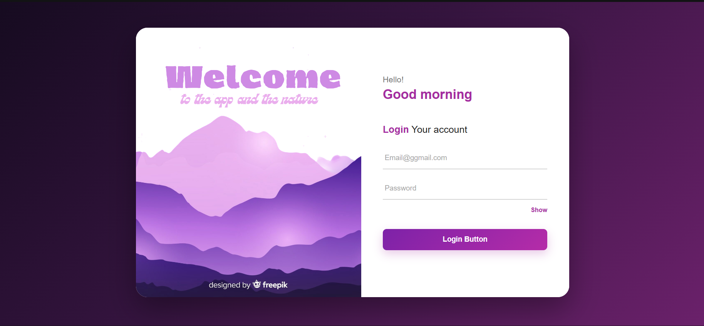

🔐 Login Page – React

  A modern, responsive login page built using React.js and CSS.
   
  Features interactive form validation, password visibility toggle, and responsive styling.

## 🖥️ Project Preview

## 🚀 Features

Feature

Description

📱 Responsive Design

Compatible with desktop, tablet, and mobile devices.

📧 Email Validation

Checks for missing email input.

🔑 Password Validation

Checks for missing password input.

🔐 Login Authentication

Validates credentials against predefined values.

👁️ Show/Hide Password

Toggle password visibility.

⚛️ React State

Manages form inputs using useState.

⚡ Interactive UI

Displays alerts for login success and errors.

🎨 Modern Styling

Gradient background, animations, and hover effects.

## 🛠️ Technologies Used

  
  
  
  

## ⚙️ Installation & Setup

1. Clone the repository

git clone YOUR_REPOSITORY_URL

2. Navigate to the project directory

cd Login-Page

3. Install dependencies

npm install

4. Start the development server

npm run dev

Open the local URL displayed in your terminal.

## 🔑 Demo Credentials

Field

Credentials

📧 Email

Vasu@gmail.com

🔑 Password

Vasu@123

📱 Responsive Design

The application adapts to different screen sizes:

Desktop: Image and login form displayed side by side.

Tablet: Adjusted image and form proportions.

Mobile: Image and login form displayed vertically.

## 📚 Learning Outcomes

This project helped me practice:

React functional components.

State management using useState.

Event handling using onChange and onClick.

Conditional rendering.

Form validation with JavaScript.

CSS Flexbox and positioning.

Responsive design using media queries.

CSS transitions and animations.

## ⚠️ Important Note

This is a frontend practice project. Login credentials are hardcoded for demonstration purposes. There is no backend or database authentication. It is not intended for production use.

## 👨‍💻 Author

Vasu

React learning project focused on improving frontend development, JavaScript, and CSS skills.